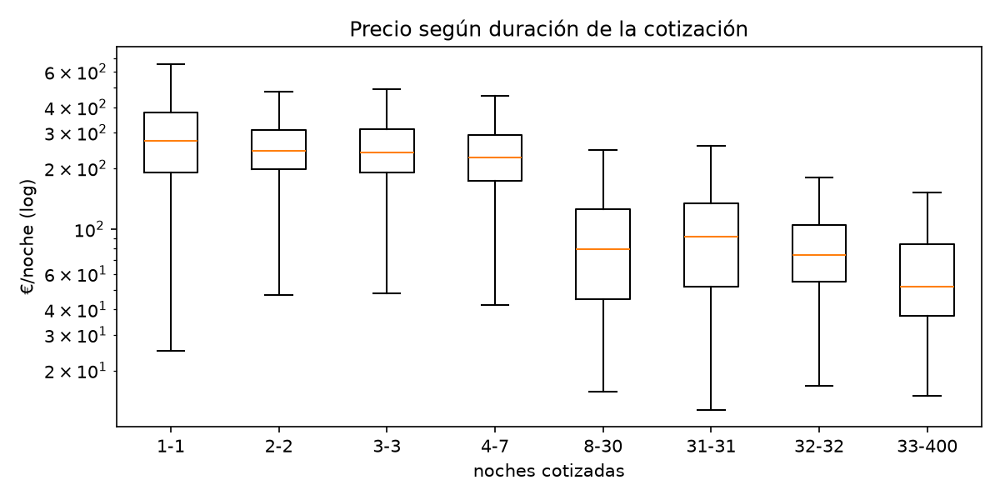
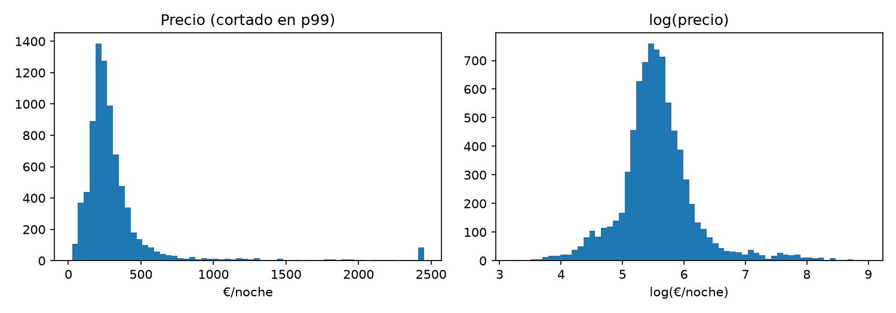
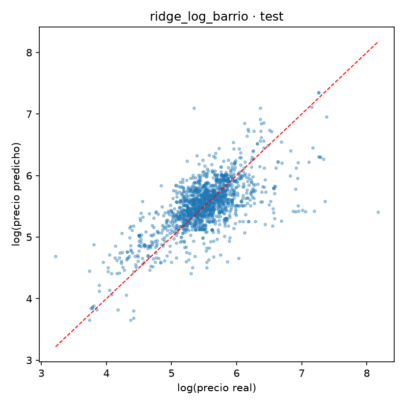

# Projecte 5: How much is this flat worth? (Inside Airbnb Barcelona)

Aprenentatge Computacional (UAB) · Curs 2026-27

**Equip:** Joel Leon (1750060) · David Gomez (1749837) · David Cabello (1745464)
**Grup / subgrup:** ...

## Objectiu
Predir el preu per nit dels allotjaments d'Airbnb a Barcelona i identificar quines característiques n'expliquen el valor.

## Dades
* **Font:** [Inside Airbnb – Barcelona](https://insideairbnb.com/get-the-data/) (llicència CC BY 4.0), obtingudes del [repositori del curs](https://github.com/ramonbal/ml-projects-2026-27/tree/main/05-airbnb-bcn).
* `data/2026-09-17/listings.csv.gz`: snapshot de setembre de 2026 (15.236 anuncis, 90 columnes). **Snapshot principal.**
* `data/2026-09-17/neighbourhoods.geojson`: polígons dels barris i districtes.
* `data/2025-11-17/listings.csv.gz`: snapshot de novembre de 2025 (17.934 anuncis, 79 columnes). Vegeu la Decisió 0.1.

## Com reproduir-ho
```bash
git clone https://github.com/dartrix42/Projecte-AC-How-much-is-this-flat-worth-.git
cd Projecte-AC-How-much-is-this-flat-worth-
conda env create -f environment.yml
conda activate ml-airbnb
python src/baseline.py          # setmana 1: genera results/ i figures/
```

## Estructura del repositori
```
data/        snapshots d'Inside Airbnb (una carpeta per data)
src/         codi (baseline.py: setmana 1)
notebooks/   exploració per setmanes
results/     taules i xifres generades pel codi (prefix w1_ = setmana 1)
figures/     gràfics usats al decision log
```

# Decision log
Format de cada entrada: **Problema → Proposta → Evidència → Anàlisi → Decisió**.
Totes les xifres de la setmana 1 surten de `python src/baseline.py` (resum a `results/w1_summary.json`).

## Setmana 1: exploració, split i baseline

### Decisió 0.1: quin snapshot fem servir
* **Problema:** tenim dos snapshots, però la columna `price` no mesura el mateix. Al 2025 és el preu anunciat per nit; al 2026 és el preu per nit d'una cotització per a una estada concreta (dates i durada determinades). Barrejar-los o comparar-los directament voldria dir barrejar dues variables objectiu diferents. A més, el 2026 té columnes (`price_quote_*`) que el 2025 no té.
* **Proposta:** treballar les setmanes 1–3 només amb el 2026, que és el més recent i l'únic on sabem exactament a quina estada correspon el preu. Reservar el 2025 per a la setmana 4, per avaluar com generalitza el model a un altre període, i tractar la diferència de definició com a part d'aquella anàlisi.
* **Evidència:**
  * Al 2026, `price` coincideix amb `price_quote_price_per_night` en el **100 %** de les files on hi ha les dues: és la cotització d'una estada concreta.
  * El 2026 té 11 columnes que el 2025 no té, entre elles totes les `price_quote_*` (data d'entrada i sortida, preu total). Al 2025, `price` és el preu anunciat.
* **Anàlisi:** qualsevol diferència de rendiment entre anys barrejarà dos efectes: el canvi de mercat i el canvi de definició del preu. No la podrem atribuir només al pas del temps. A més, la segmentació del mercat al 2026 fa servir la durada de la cotització (Decisió 0.2), que al 2025 no existeix: abans de la setmana 4 caldrà un criteri comú als dos anys (p. ex. `minimum_nights`).
* **Decisió:** el 2026 és l'únic snapshot d'entrenament i avaluació a les setmanes 1–3. El 2025 queda reservat: no s'usa ni per entrenar ni per prendre decisions fins a la setmana 4.
* **Owner:** [nom]

### Decisió 0.2: abast del mercat, target i preus ausents
* **Problema:** al 2026 el preu depèn de la durada de l'estada cotitzada: la mediana és de 225–272 € per nit fins a 7 nits, cau a ~80 € a partir de 8 nits i queda en 52–92 € per a estades de 31 nits o més. El 35 % dels anuncis amb preu tenen una cotització de 31 nits o més: un sol model barrejaria dos mercats (turístic i de temporada) amb preus per nit molt diferents. A més, el 17,2 % dels anuncis no tenen preu i la distribució té una cua molt llarga (mediana 252 €, màxim 7.679 €).
* **Proposta:**
  1. **Abast:** només el mercat turístic (cotització de 7 nits o menys). S'exclouen la temporada (31 o més) i els casos ambigus (8–30 nits, 160 anuncis), que és on es produeix el salt. El criteri és el nombre de nits de la cotització i no `minimum_nights`, perquè és la durada a la qual correspon realment el preu (els dos criteris discrepen en 403 anuncis i `minimum_nights` té 1.876 nuls).
  2. **Target:** log(preu). La distribució és molt asimètrica i l'error rellevant és relatiu: equivocar-se en 50 € no és el mateix en un pis de 60 € que en un de 600 €.
  3. **Anuncis sense preu:** s'exclouen, perquè sense target no es poden fer servir per entrenar ni per avaluar.
  4. **Extrems:** no es toquen a la setmana 1.
* **Evidència:**

  | Noches cotitzades | n | Mediana €/nit |
  |---|---|---|
  | 1 | 3.636 | 272 |
  | 2 | 2.647 | 243 |
  | 3 | 1.248 | 240 |
  | 4–7 | 468 | 225 |
  | 8–30 | 160 | 80 |
  | 31 | 1.976 | 92 |
  | 32 o més | 2.475 | 52–74 |

  

  * Preus ausents: 2.626 de 15.236 (17,2 %). 35,6 % en hosts amb 1 anunci i 10,4 % en hosts amb 20 o més; 31,3 % en habitacions privades i 11,5 % en pisos sencers.
  * Target: amb el mateix split, el Ridge sobre log(preu) dona RMSE_log = 0,373; sobre el preu en euros, 1,184.
  * Extrems (mercat turístic): mediana 252 €, p99 2.450 €, màxim 7.679 €. El top 10 són *group flats* de 27 a 54 persones amb `accommodates` tallat a 16 (`results/w1_top_precios.csv`).

  
* **Anàlisi:**
  * El règim canvia just entre 7 i 8 nits, cosa coherent amb descomptes setmanals i mensuals i amb pisos pensats per a lloguers de temporada: són dos mercats. Dins del turístic encara hi ha un efecte de la durada (272 € per a 1 nit contra 225 € per a 4–7 nits, probablement la neteja repartida entre menys nits), que de moment no modelem.
  * El log no guanya només perquè la mètrica estigui en log: també en euros el Ridge sobre log(preu) és millor (MAE 81 € contra 147 € al split definitiu).
  * Els preus ausents no són aleatoris: falten molt més en hosts petits (35,6 % amb 1 anunci contra 10,4 % amb 20 o més) i en habitacions privades (31,3 %). El model representa millor hosts professionals i pisos sencers; és una limitació de les dades que no podem corregir.
  * Els preus més alts són *group flats* de 27 a 54 places on `accommodates` val 16 (el màxim que permet Airbnb): el model no pot veure la seva mida real. Alguns semblen errors (p. ex. un pis de 2 habitacions per a 4 persones a 6.129 €).
* **Decisió:** l'abast és el mercat turístic amb preu: 7.999 anuncis (el 63 % dels que tenen preu). Target: log(preu). Els extrems es mantenen a la setmana 1; el seu tractament (aplicat només a train) és una pregunta de la setmana 2. Limitació: biaix cap a hosts professionals.
* **Owner:** [nom]

### Decisió 0.3: split aleatori o agrupat per host
* **Problema:** molts hosts gestionen molts anuncis gairebé iguals (2.072 hosts per a 7.999 anuncis i 626 anuncis gairebé idèntics). Amb un split aleatori, anuncis del mateix host cauen alhora a train i a test: el model pot "reconèixer" l'host en comptes d'aprendre a estimar pisos nous, i la mètrica surt massa optimista.
* **Proposta:** split agrupat per `host_id` (`GroupShuffleSplit`, test del 20 %): cap host apareix alhora a train i a test. És el cas d'ús real: estimar el preu d'un pis d'un host que el model no ha vist.
* **Evidència:** 5 repeticions de cada split (test del 20 %), Ridge log + barri (`results/w1_split_comparison.csv`):

  | Split | % test amb host a train | RMSE_log (mitjana ± desv.) | MAE € (mitjana ± desv.) |
  |---|---|---|---|
  | Aleatori | 84,2 % | 0,381 ± 0,011 | 107 ± 6 |
  | Agrupat per `host_id` | 0 % | 0,419 ± 0,077 | 124 ± 92 |

  * 626 anuncis gairebé idèntics (mateix host, barri, tipus, capacitat, habitacions i preu); 2.072 hosts distints per a 7.999 anuncis.
* **Anàlisi:**
  * Amb el split aleatori, el 84,2 % dels anuncis de test tenen el seu host a train, i l'RMSE_log és més baix (0,381 contra 0,419): l'aleatori és més optimista.
  * Tanmateix, la diferència (0,038) és més petita que la desviació del split agrupat (±0,077), així que per si sola no demostra la fuga. L'argument principal és el solapament del 84 %: és una fuga per construcció, independentment de quant mogui la mètrica en aquest model.
  * La desviació tan gran del split agrupat (MAE ±92 €) indica que el resultat depèn molt de quins hosts cauen a test, probablement uns quants hosts grans amb pisos cars. Una sola partició no és fiable: la del split definitiu (seed 42, RMSE_log 0,373) és més favorable que la mitjana.
* **Decisió:** split agrupat per `host_id`. Reportem la mitjana ± desviació de les 5 repeticions; a la setmana 2 passarem a validació creuada agrupada (`GroupKFold`) per tenir una estimació estable.
* **Owner:** [nom]

### Baseline de la setmana 1
Split agrupat per host. Mitjana de 5 repeticions (`results/w1_split_comparison.csv`):

| Model | RMSE_log | MAE € |
|---|---|---|
| Mediana global | 0,581 | 155 |
| Mediana per barri × tipus | 0,527 | 147 |
| Ridge log + districte | 0,421 | 125 |
| **Ridge log + barri** | **0,419** | **124** |

Al split definitiu (seed 42, `results/w1_metrics_final.csv`), el Ridge log + barri dona RMSE_log = 0,373, R²_log = 0,45 i MAE = 81 €. Aquesta partició és més favorable que la mitjana de les repeticions.



* **On falla** (`results/w1_errors.csv`): sobreprediu els pisos barats (biaix +0,27 en log al quintil inferior) i infraprediu els cars (−0,30 al superior). Els pitjors errors són pisos grans de l'Eixample i suites de luxe.
* **Anàlisi:**
  * Amb variables poc informatives (sense coordenades, sense qualitat del pis i amb `accommodates` tallat a 16), el Ridge no distingeix bé els pisos extrems i les prediccions es concentren cap al centre: sobreprediu els barats i infraprediu els cars.
  * Les pitjors sobrepredicions són pisos de 13–15 places a la Dreta de l'Eixample amb preus moderats: el model extrapola linealment la capacitat. Les pitjors infrapredicions són pisos de luxe (Passeig de Gràcia, "Royal Suite"): una qualitat que les variables actuals no recullen.
  * Barri i districte donen gairebé el mateix (0,419 contra 0,421): amb codificació categòrica, el detall del barri aporta poc. Això motiva provar la ubicació exacta (pregunta 3 de la setmana 2).
  * El biaix de les habitacions d'hotel (+0,45 en log) es basa en només 16 anuncis de test: no és fiable.

## Preguntes per a la setmana 2
1. Quin impacte té tractar els outliers extrems (p. ex. percentil 99) sobre el rendiment, si el filtre s'aplica només a train i s'avalua sobre el test complet?
2. Per què el resultat del split agrupat varia tant d'una partició a una altra? Amb una validació creuada agrupada (`GroupKFold`) obtenim una estimació estable?
3. Millora la predicció si substituïm el barri categòric per la ubicació exacta (kNN geogràfic)?
4. Quin model (Random Forest / boosting vs Ridge) captura millor les interaccions entre capacitat, tipus d'allotjament i ubicació?

## Setmana 2 · Setmana 3 · Setmana 4
(pendents)

## Resultats i valoració crítica
(pendent)
